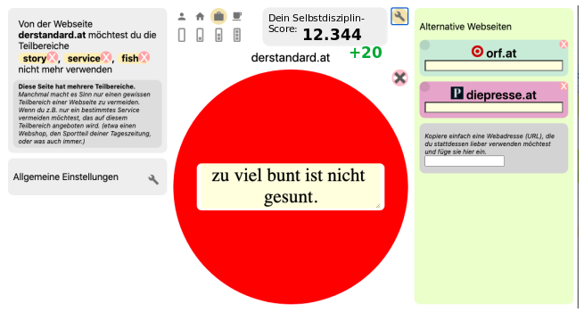

# Affiliate Fair-Play-Policy

Shape My Web leitet Traffic um. Das ist der Zweck dieser Browserextension.

Wir wollen dies an einem Beispiel deutlich machen:

User, die z. B. nicht mehr auf Amazon einkaufen wollen, sollen auf andere,
alternative Webseiten umgeleitet werden. Gelingt dies, folgt der User seinen
Überzeugungen und vermeidet z. B. Amazon und geht stattdessen auf eine andere
Webseite, werden selbstverständlich sämtliche Affiliate-Links auf Amazon
hinfällig. Der User folgt dann einem selbst erstellten Link, für den er sogar
einen selbst erstellten Affiliate-Link angeben kann. D. h.: Haben Sie versucht,
den User auf eine Amazon-Seite zu verlinken, dann haben Sie in diesem Fall Pech
gehabt. Der User folgt letztlich seinem eigenen Link und Ihr
Amazon-Affiliate-Link ist gebrochen.

Sollte sich der User jedoch entscheiden, in diesem Fall eine Ausnahme von
seinen Vorsätzen zu machen und nach unserem Warnhinweis doch auf die Seite von
Amazon zu gehen (mit den Tasten Pass-By, Pause, Clear, …), dann wird exakt dem
originalen Link (mit Ihrem Affiliate-Link) gefolgt. In diesem Fall bleibt Ihr
Affiliate-Link vollends aufrecht. (Wir könnten natürlich Ihren Affiliate-Link
durch unseren eigenen ersetzen, doch das halten wir nicht für fair – darum tun
wir es nicht.) Senden Sie also den User zu Amazon und er geht trotz unseres
Filters auf Amazon, erhalten Sie Ihre Provision. Das halten wir für Fair-Play.

## Listenpartner

Komplizierter wird es bei unseren Listenpartnern. Listenpartner können selbst
Blacklists mit alternativen Webseiten anbieten und sie können auch ihre eigenen
Affiliate-Links an die empfohlenen Webseiten anfügen. Nun kann es aber
vorkommen, dass Listenpartner A eine alternative Webseite X mit seinem
Affiliate-Link Xa versieht, während ein anderer Listenpartner B die gleiche
alternative Webseite X mit seinem Affiliate-Link Xb versieht.

Der User kann ja beide Listen buchen, sieht aber nicht, von welcher Liste ihm
die alternative Webseite X empfohlen wurde. Er soll damit auch nicht belästigt
werden. Wir halten es für fair, dass in diesem Fall abwechselnd die
Affiliate-Links Xa, Xb zum Einsatz kommen.

## Skizze: Selbstdisziplin-Score

